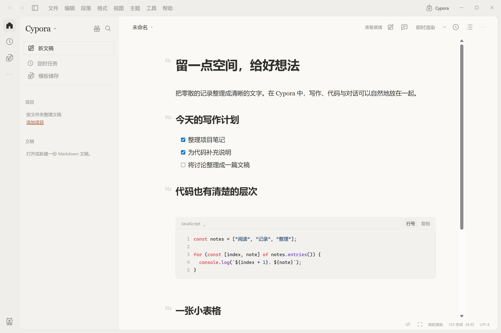
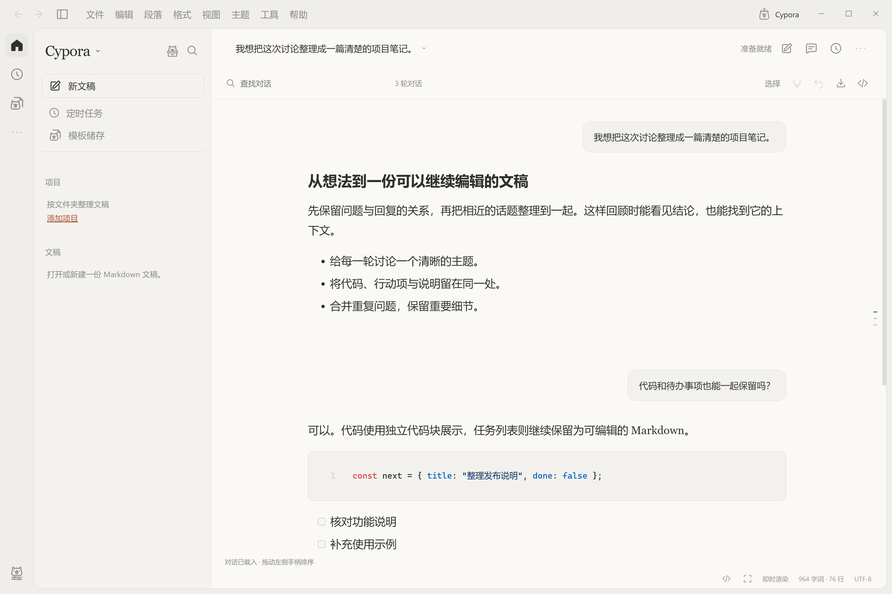

<div align="center">
  
  <h1>Cypora</h1>
  <p>让文字、代码和对话，回到一个安静的写作空间。</p>
  <p>本地优先 · Markdown 编辑 · 对话整理 · Windows 桌面应用</p>
  <p><a href="https://wasserbitter.edu.kg/">官网</a> · <a href="#快速开始">快速开始</a> · <a href="#功能介绍">功能介绍</a> · <a href="#赞助与交流">赞助与交流</a></p>
</div>

Cypora 是一款自主设计与实现的本地 Markdown 工作空间，将写作、代码阅读、对话整理、项目文稿、模板和提醒放在同一个桌面应用中。界面采用温暖的纸张色、克制的留白和单色水豚线稿图标，支持浅色、深色与个性化配色。

Cypora 使用 Electron、Vditor 和 MathJax 等开源组件构建。文稿以普通 Markdown 文件保存在本机，无需注册 Cypora 账户，也不依赖在线 AI 服务。

> 当前版本：**0.8.0**。当前发布目标：**Windows x64**。项目仍在持续完善，具体支持范围见本文的「已知限制」。

## 赞助与交流

感谢 [**Capybara token**](https://wasserbitter.edu.kg/) 对 Cypora 的赞助与支持。

- 官网：[wasserbitter.edu.kg](https://wasserbitter.edu.kg/)
- QQ 交流群：**1127484380**
- 使用问题和功能建议：请在本仓库的 Issues 中提交，并附上复现步骤、版本与必要的截图。

## 界面预览





## 快速开始

### 使用 Windows 便携版

1. 打开本仓库的 **Releases** 页面，下载 `Cypora-v0.8.0-windows-x64.zip`。
2. 将压缩包完整解压到一个可写目录。
3. 打开目录中的 `Cypora.exe`。
4. 新建文稿，或将现有 Markdown 文件加入项目文件夹。

便携包无需安装 Node.js。请保留 EXE 旁的 `resources`、语言包和运行库，不能只复制 EXE。

这里的「便携版」表示解压即可运行；设置、草稿和提醒仍存放在 Windows 当前用户的应用数据目录中。发布包不包含用户文稿、登录状态或测试配置。

### 从源码运行

需要 Windows、Node.js 和 npm。项目使用锁定依赖，建议用 `npm ci` 安装。

```powershell
npm ci
npm start
```

克隆或下载源码后，在项目根目录执行以上命令。首次安装依赖需要网络；本地文稿编辑、已安装的数学渲染和代码高亮可离线使用。引用远程图片或打开网页链接时仍需要网络。

## 功能介绍

### Markdown 写作与排版

| 功能 | 说明 |
| --- | --- |
| 三种编辑模式 | 即时渲染、所见即所得、源码与预览，按写作习惯切换 |
| 标题与段落 | 六级标题、正文、提升/降低标题层级、引用、分隔线 |
| 行内格式 | 粗体、斜体、下划线、删除线、高亮、行内代码、上下标 |
| 列表 | 无序列表、有序列表、任务列表、任务完成状态与缩进 |
| 内容结构 | 表格、代码块、数学块、链接、图片、脚注、引用链接、HTML、YAML 元信息 |
| 提示块 | 注释、提示、重要、警告与注意内容块 |
| 大纲 | 标题跳转、章节折叠/展开、当前章节高亮、跟随滚动、显示层数 |
| 文稿工具 | 文内查找与替换、文稿统计、预计阅读时间、只读、专注与打字机模式 |

标题和格式命令会处理当前段落或选择的内容。编辑偏好支持括号/Markdown 配对、Emoji 补全、智能引号与破折号、缩进宽度、空格或 Tab、标题与列表标记等；设置不会批量重写已有文稿。

### 代码块

- 代码块内提供语言入口，可搜索语言或输入自定义语言名称。
- 语法高亮、自动行号、自动换行、字体、字号、连字与代码配色。
- 语言修改支持撤销、重做；行号和控件不会混入保存的 Markdown。
- 右键复制代码、选择语言、切换行号/换行、增加或减少代码行缩进。
- 支持在代码块前后插入段落以及删除代码块。
- 源码模式下支持代码内容复制与代码块删除。

代码行缩进不等于完整的语言语法格式化，当前不会宣称自动修复任意代码格式。

### 数学内容

使用本地 MathJax SVG 渲染，支持行内数学、独立数学块和公式编号设置。Markdown 中保留原始 LaTeX，公式块右键可以复制 LaTeX 源码。

### 表格、链接和图片

**表格**支持插入、删除和移动行列，设置列对齐，复制 Markdown 与格式化表格源码；结构操作可以撤销。

**链接**支持打开、复制地址、修改地址和取消链接，编辑时保留链接文字与邻近正文。

**图片**支持：

- 插入本地图片、网络图片链接与剪贴板图片。
- 链接原图，或复制到文稿的附件文件夹。
- 相对/绝对路径、可选 `./` 前缀、图片路径转义。
- 复制图片内容或地址、另存为 PNG、打开图片及其本地位置。
- 修改图片地址、替代文字和标题，设置宽度或恢复原始大小。
- Markdown 与 HTML 图片语法切换。

需要复制到附件目录时，应先保存文稿。同名附件不会直接覆盖。网络图片能否复制内容取决于浏览器的跨域读取限制。将带尺寸的 HTML 图片转换为普通 Markdown 后，Markdown 语法本身不能保留该尺寸。

### 对话工作台

将长对话整理成可搜索、可编辑的知识文稿，而不仅是一段很长的聊天记录。

1. 通过 **文件 → 导入 Codex 对话** 选择本机会话、JSON/JSONL 文件，或粘贴文本。
2. 多份对话可以合并成一份文稿；导入过程只读原始会话。
3. 用户问题与回复在中央阅读区域分层排版。
4. 编辑消息、折叠整轮对话、搜索高亮、多选合并、删除及撤销。
5. 拖动左侧手柄调整整轮顺序；手柄获得焦点后，也可用 `Alt+↑` / `Alt+↓` 排序。
6. 右侧短横线导航提供悬停预览、点击跳转与拖动浏览。
7. 保存为 Markdown，重新打开可恢复对话视图，也可以切回源码编辑。

本机安装了 Typora 时，可以从文件菜单在 Typora 中打开已保存文稿。其他 Markdown 编辑器可以阅读其中的标题和消息；折叠、合并、拖拽等交互由 Cypora 提供。

当前导入保留文字消息、代码和 LaTeX，不导入图片、音频等附件和工具输出。遇到不能完整解释的对话结构时，保留原文并回到普通 Markdown 编辑，避免静默丢失文字。可先打开 [对话示例](examples/对话工作台.md) 体验。

### 文稿与项目管理

- 用真实文件夹组织项目，展开文稿，搜索文件名和内容。
- 新建、打开、置顶、重命名、移动、创建副本、复制路径、查看属性。
- 文稿、项目和置顶区域支持手动排序，访问文件不会自动打乱手动顺序。
- 归档隐藏文稿列表项，恢复后重新显示；归档不删除磁盘文件。
- 删除文稿需要确认，并使用系统回收站。
- 移除项目只移除应用内关联，保留项目文件夹。
- 文件副本自动避开同名文件，保留原文和原有相对图片引用。

跨目录移动时，Cypora 会处理默认的文稿专属 `.assets` 附件目录。自定义共享图片目录和跨目录另存为的附件迁移需要自行整理。

### 保存与恢复

已有文件可自动保存，未命名文稿有恢复草稿。检测到文件被外部程序修改时，自动覆盖会暂停；保存前保留最近一次备份。支持换行符、末尾换行和 UTF-8 文稿处理。

归档、关闭列表项和移除项目均不等同于删除文件。重要文稿仍建议另外备份或使用版本管理。

### 模板与提醒

**模板**：保存当前文稿为模板，直接编辑 Markdown 模板，搜索、删除，并在指定项目中创建新文稿。不会用模板覆盖已存在的同名文件。

**提醒**：单次、每天、工作日或每周提醒，可关联项目与文稿。支持编辑、暂停、恢复、删除和提醒记录；点击关联项打开文稿或定位项目。

提醒按本机时区运行。有启用任务时，关闭窗口可以留在托盘继续提醒；彻底退出应用后停止运行。休眠、关机或退出期间错过的提醒会在下次启动或恢复时补发一次，不会逐个补发所有错过的周期。

### 外观、窗口与快捷键

| 分类 | 可调整内容 |
| --- | --- |
| 主题 | 浅色、深色、跟随系统及纸张模式；预设主题、独立浅深配色 |
| 颜色 | 强调色、背景色、前景色、对比度与侧栏效果 |
| 字体 | 界面、正文和代码字体，字号、字重、斜体与连字 |
| 阅读 | 行距、阅读列宽、全宽、首行缩进、界面密度和缩放 |
| 动画 | 减少动态效果，尊重减少动画偏好 |
| 主题交换 | 导入或复制 Cypora 主题 JSON，仅包含外观设置 |
| 窗口 | 恢复上次文稿、记住大小位置、置顶、关闭确认与托盘行为 |
| 通知 | 显示时机、声音、内容预览、应用内提醒和系统通知设置 |
| 快捷键 | 命令/按键搜索、录制组合、冲突检查、取消分配、单项或全部重置 |

快捷键使用系统保留组合时会提示冲突。字体实际显示取决于本机安装的字体。

### 导出与打印

支持 HTML、PDF 和系统打印。PDF/打印可以选择 A4、A5、Letter、横向/纵向与页边距。PDF 导出等待图片加载；图片缺失时给出错误，不把缺图文稿当作完整导出。

HTML 中引用的本地图片需要和导出文件一起妥善保存或调整链接，不能把 HTML 导出理解成包含所有附件的单文件归档。

## 常用操作

| 操作 | 入口 |
| --- | --- |
| 全局文稿搜索 | `Ctrl+K` |
| 标题与正文 | `Ctrl+1` 至 `Ctrl+6`，`Ctrl+0` |
| 调整段落、表格、代码或图片 | 编辑区域右键菜单 |
| 导入对话 | 文件 → 导入 Codex 对话 |
| 对话键盘排序 | 焦点位于拖动手柄时按 `Alt+↑` / `Alt+↓` |
| 自定义快捷键 | 设置 → 快捷键 |
| 调整图片保存位置 | 设置 → 图像 |
| 修改 PDF 页面 | 设置 → 导出 |

## 开发与打包

```powershell
# 安装锁定依赖并启动
npm ci
npm start

# 后台回归：不显示测试窗口或右键菜单
npm test
npm test -- --extensions-only
npm run test:context-menu

# 独立模型和文件测试
npm run test:planner
npm run test:settings
npm run test:conversations
npm run test:file-preferences
npm run test:attachments

# 构建暂存的 Windows 应用
npm run package -- --stage

# 生成干净的源码包、Windows 便携包及 SHA-256 清单
npm run release
```

`npm run package` 不加 `--stage` 时会更新当前用户安装目录并刷新快捷方式，应先退出正式应用；暂存构建不会覆盖正式安装。`npm run release` 使用独立的发布目录，不会把测试配置或内部工作资料放入发布包。

自动化检查使用临时文稿和独立配置。图片剪贴板、系统打开文件及部分对话框使用测试替身；不能将自动化通过等同于每台电脑、每个外部软件的人工兼容性验收。

## 已知限制

- 目前只提供 Windows x64 发布包，没有验证 macOS、Linux 或 Windows ARM 原生版本。
- 当前没有 AI 对话服务、账户同步、云存储、图床上传、自动升级或开机自启动。
- 未提供完整的语言语法代码格式化、选区复制为图片、MathML 剪贴板输出和完整系统拼写词典管理。
- 对话导入不保留多媒体附件和工具输出。
- 不是多窗口编辑器，也不提供完整的文件夹树管理。
- 富文本模式再次解析可能规范化部分 Markdown 标记，不能作为字节级源码格式保持器。
- 文稿搜索单文件内容上限为 1 MB，最多返回 80 项；项目扫描最多五层子目录和 1500 个文稿，跳过隐藏目录、符号链接与 `node_modules`。
- 当前最多保存 500 个提醒、200 个模板和 200 条提醒记录；单个模板正文上限为 2 MB。
- 模板中的相对图片路径以新文稿所在目录为准；共享附件和跨目录另存为需自行整理。

## 技术与许可证

Cypora 的应用逻辑、工作空间和交互设计自主实现，项目代码使用 [MIT License](LICENSE)。开源依赖及其许可证独立保留，详见 [第三方组件声明](THIRD_PARTY_NOTICES.md)。

| 组件 | 用途 |
| --- | --- |
| Electron | Windows 桌面窗口、文件交互与系统集成 |
| Vditor | Markdown 编辑、高亮和渲染基础 |
| MathJax | 本地数学内容 SVG 渲染 |
| MathJax New Computer Modern | 数学渲染字体 |
| Lucide | 部分界面线性图标 |

欢迎提交问题、功能建议和改进代码。反馈时请尽量使用不含个人信息的最小示例；不要上传登录令牌、私密会话或完整用户配置目录。
